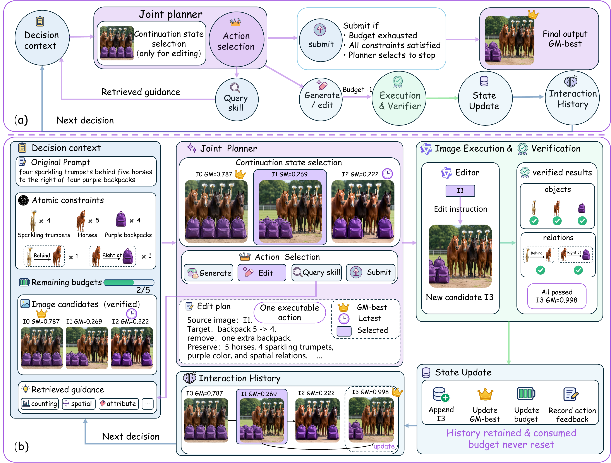
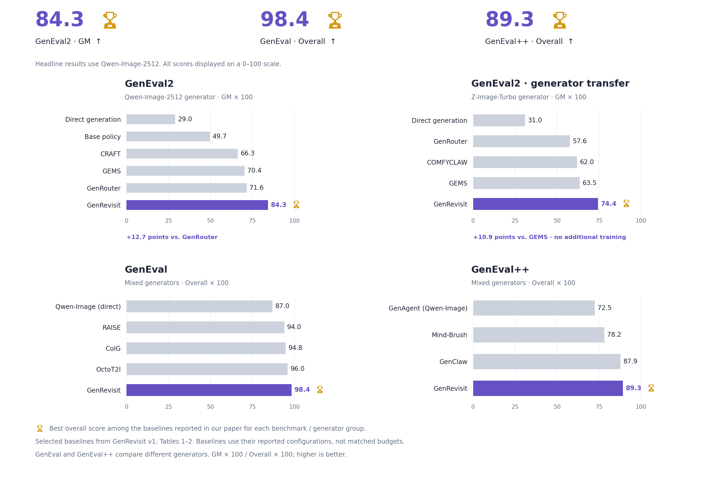

<h1 align="center"></h1>

<p align="center">
  <b><em>Look Back to Move Forward: Learning to Revisit for Agentic Compositional Image Generation</em></b>
</p>

<p align="center">
  <a href="https://arxiv.org/abs/2610.16224"></a>
  &nbsp;
  
  &nbsp;
  <a href="https://huggingface.co/GenRevisit/GenRevisit-RL"></a>
  &nbsp;
  <a href="https://modelscope.cn/models/GenRevisit/GenRevisit-RL"></a>
</p>

<p align="center">
  <a href="https://github.com/Flipped-zx/GenRevisit"></a>
</p>

---

## 💡 Overview

**GenRevisit** is an agentic framework for compositional text-to-image generation. Existing agentic approaches refine images iteratively but typically fix the *continuation state* — the image from which refinement proceeds — to the latest candidate. Since iterative editing is not necessarily monotonic, the agent may continue refining from an image that has already degraded, wasting its budget restoring constraints that were previously satisfied.

GenRevisit extends action selection to **joint continuation-state and action selection**: at each decision step, a multimodal planner not only adjusts its editing instruction based on the interaction history, but also selects *which* historical image candidate to continue from — jointly deciding **where to continue from** and **how to refine**.

The planner is trained in two stages:

1. **Supervised fine-tuning (SFT)** on multi-round teacher trajectories, supervising only actions that improve the image (including recovery from degraded states), while failed actions remain in the context as recovery cues.
2. **Reinforcement learning (RL)** with GRPO, augmented by **Normalized Action Credit Assignment (NACA)**, which redistributes positive trajectory-level advantage among generation and editing actions according to each action's normalized contribution to closing the remaining utility gap — instead of assigning the same advantage to every action in the trajectory.

## Framework

[](assets/framework.pdf)

## Method

The framework consists of three components:

- **History-conditioned interaction.** The decision context includes the prompt's atomic constraints (each paired with a VQA-style verification question), all historical image candidates with their constraint-level feedback, retrieved guidance, and the remaining budget. At each step the agent emits one structured action: `generate`, `edit`, `query_skill` (retrieve guidance), or `submit`. For `edit`, the action jointly specifies a source image index from the interaction history (the continuation state) and an editing instruction. Submission returns the historical GM-best image.
- **Supervised fine-tuning for cold start.** Teacher trajectories are collected with GPT-5.5; only improving actions receive imitation loss (masked SFT), while degraded actions and their feedback remain in context to inform later decisions.
- **RL with Normalized Action Credit Assignment (NACA).** The terminal reward measures how well the final submitted image satisfies the task constraints. For positive-advantage trajectories, NACA redistributes credit among image actions in proportion to the fraction of the remaining utility gap each action closes, so regressive actions in otherwise successful trajectories are not spuriously reinforced. Non-positive advantages are left unchanged.

## Performance



GenRevisit achieves state-of-the-art compositional generation performance among the evaluated baselines:

- **GenEval2:** 84.3 GM with Qwen-Image-2512 and 74.4 GM with Z-Image-Turbo (without additional training), surpassing the strongest agentic baselines using the same generators by **12.7** and **10.9** points respectively.
- **Cross-benchmark generalization:** best overall scores on **GenEval** (0.9844) and **GenEval++** (0.8929).
- **Ablations:** SFT + NACA (84.3 GM) outperforms SFT-only (81.5) and SFT + standard GRPO (80.3) on GenEval2; joint continuation-state selection outperforms latest-only and best-only teacher continuations by 5.0 and 2.8 GM points under matched budgets.

## Model Setup

Download the planner and image tools to local directories:

```bash
python -m pip install -U huggingface_hub

# Planner: final GenRevisit policy
hf download GenRevisit/GenRevisit-RL --local-dir models/GenRevisit-RL

# Image generator
hf download Qwen/Qwen-Image-2512 --local-dir models/Qwen-Image-2512

# Image editor
hf download Qwen/Qwen-Image-Edit-2511 --local-dir models/Qwen-Image-Edit-2511

# Alternative generator: cross-generator evaluation
hf download Tongyi-MAI/Z-Image-Turbo --local-dir models/Z-Image-Turbo

# Base planner: needed only for training from the original backbone
hf download Qwen/Qwen3-VL-8B-Instruct --local-dir models/Qwen3-VL-8B-Instruct
```

## Installation

```bash
python -m pip install -e .
```

For RL training components:

```bash
python -m pip install -e ".[rl]"
```

## Usage

### Agent

The agent reads task constraints, candidate images and feedback, then emits one structured action: `query_skill`, `generate_image`, `edit_image`, or `submit_attempt`.

See [Agent](docs/agent.md) for input fields, action schemas, validation and message rendering.

### SFT

Prepare a LLaMA-Factory compatible dataset and a local base model. Then run:

```bash
python scripts/train_sft.py \
  --model-dir "$MODEL_DIR" \
  --dataset-dir "$DATASET_DIR" \
  --output-dir "$OUTPUT_DIR"
```

The default dataset names are `sft_train` and `sft_validation`. Use `--train-dataset` and `--eval-dataset` if your `dataset_info.json` uses different names. The launcher reads `configs/sft/full_sft.yaml` and substitutes the local paths.

### RL / NACA

The modules in `src/genrevisit/train/` provide NACA action credit, the GRPO loss, and an optimizer step for prepared training batches. The configuration is in `configs/rl/naca_grpo.yaml`.

## Repository Structure

```text
GenRevisit/
├── assets/                  Project artwork
├── configs/
│   ├── sft/                 SFT and DeepSpeed configuration
│   └── rl/                  NACA and GRPO configuration
├── docs/                    Agent interface documentation
├── scripts/                 SFT training launcher
├── src/genrevisit/
│   ├── agent/               Field contracts, schemas and message rendering
│   └── train/               Credit allocation, loss and optimizer step
└── tests/                   Agent and training checks
```

## Tests

```bash
python -m pip install -e ".[test]"
python -m pytest tests -q
```

## Citation

If you find GenRevisit useful in your research, please cite:

```bibtex
@article{wang2026genrevisit,
  title   = {Look Back to Move Forward: Learning to Revisit for Agentic Compositional Image Generation},
  author  = {Wang, Zixu and Zhao, Xiaoran and Liu, Yahui and Wang, Feng-ao and Xiao, Junhao and Shu, You and Liu, Bing and Liu, Yiting and Jian, Songlei and Tian, Zhiliang and Li, Dongsheng},
  journal = {arXiv preprint arXiv:2610.16224},
  year    = {2026}
}
```
